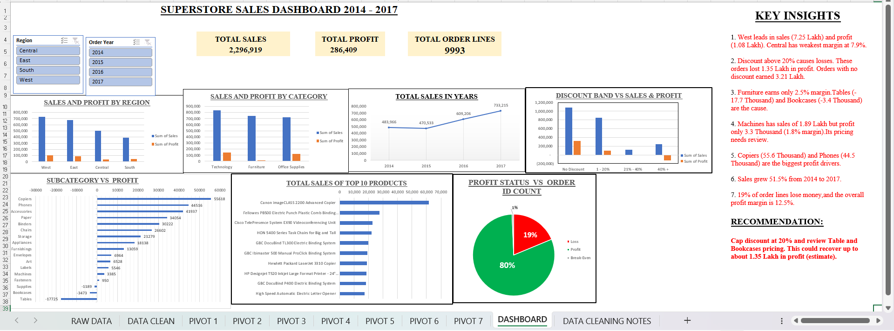

# Superstore Sales Dashboard (2014-2017)

An Excel dashboard that analyses sales, profit, discounts and sub-categories for a Superstore dataset.

## Problem
Find out which regions, categories and discounts drive or hurt profit.

## Tools Used
Excel: data cleaning, formulas, pivot tables, pivot charts, slicers

## Steps
1. Cleaned the raw data (fixed dates, added new columns)
2. Added Order Year, Profit Status, Shipping Period and Discount Band
3. Built 7 pivot tables and charts
4. Combined them into one dashboard with slicers

## Key Findings
- Total sales: 2,296,919 | Total profit: 286,409 | Profit margin: 12.5%
- West leads in sales and profit. Central has the weakest margin at 7.9%.
- Discounts above 20% caused a loss of about 135,364 in profit.
- Furniture earns only a 2.5% margin. Tables and Bookcases lose money.
- Sales grew 51.5% from 2014 to 2017.

## Recommendation
Cap discounts at 20% and review Table and Bookcase pricing.

## Files
- Superstore__Sales_dashboard.xlsx: full Excel workbook
- Superstore_Sales_Dashboard.png: dashboard image
